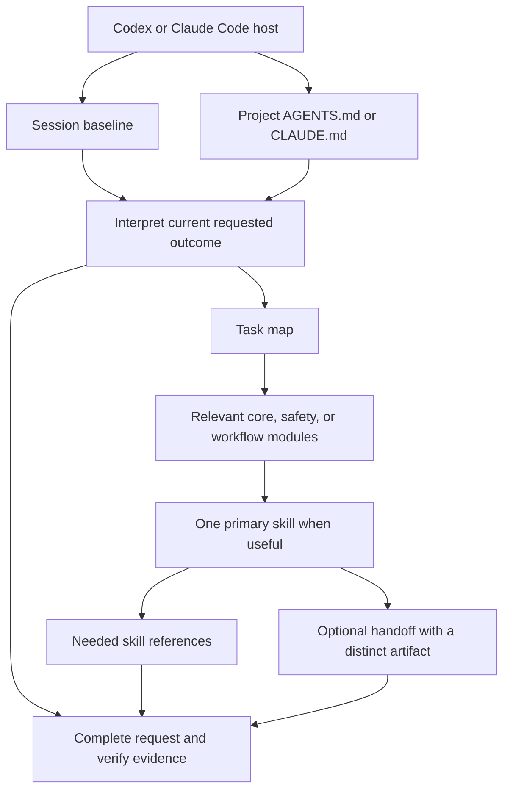

# DevBrain Architecture

DevBrain is a file-based knowledge system. It keeps always-loaded guidance small and routes deeper guidance by task, so the host can apply relevant context without loading the entire repository.

## Loading model

1. **Session baseline:** precedence, collaboration, safety, autonomy, context lifecycle, and basic workflow. Read once per coding session.
2. **Task modules:** the task map selects the core principles, safety analysis, or workflow needed for the current decision.
3. **Skill and references:** select a portable skill by the requested outcome and open supporting references only when they affect the work.
4. **Project context:** the active project's instructions own technical and product facts, including stack, visual identity, contracts, permissions, and verification commands.

This is selective routing, not a required sequence. A focused task should stay focused; a multi-domain task can involve several owners when their outputs connect.

## Session flow

Host discovery is an integration concern. The files describe intended routing and package contents. Live host evidence is required to claim that a particular Codex or Claude session loaded them. The [CLI host matrix](../evaluation/cli-host-matrix.yaml) records those checks separately from content and installer validation.

## Context and source boundaries

| Information | Owner | Why it belongs there |
|---|---|---|
| General engineering standards, collaboration, and decision behavior | `runtime/` and `core/` | Reusable across repositories |
| Risk handling and protected operations | `safety/` and the baseline | Boundaries that apply across task domains |
| A procedure for a recurring task | `workflows/` | Steps and exit evidence without making the procedure a permanent global preference |
| Specialist behavior and optional deeper detail | `skills/<name>/` | Disclosed only when that outcome applies |
| Stack, business rules, permissions, product identity, and commands | Project instructions and optional project context | Those facts change by repository |
| Current package ownership and release evidence | `devbrain.yaml`, catalogs, evaluation, and dated `docs/` reports | Machine-checkable package inventory and scoped claims |

The manifest's `always_load` entry keeps the session baseline as the only global DevBrain startup file. Do not solve a missing route by loading every core module or skill at session start. Expand the baseline only when a rule must reliably apply before task classification and cannot remain in a selective owner.

## Canonical ownership

| Concern | Canonical owner |
|---|---|
| Precedence, session loading, global boundaries | `runtime/session-baseline.md` |
| Task routing | `runtime/task-map.md` |
| Mixed-skill selection | `runtime/skill-selection.md` and `skills/catalog.yaml` |
| Engineering, collaboration, and UI/UX principles | `core/` |
| Cross-cutting safeguards and risk analysis | `safety/` |
| Task procedures | `workflows/` |
| Prompt shorthand | `prompts/commands.yaml` |
| Specialist behavior and supporting references | `skills/<skill>/` |
| Host loader content | `adapters/`; rendered by `install/` |
| Project facts and commands | The active project's `AGENTS.md` or `CLAUDE.md` |
| Optional project context domains | `project-templates/` and their corresponding project files |
| Package and behavior evidence | `evaluation/` |
| Maintainer onboarding and release history | `docs/` and `CHANGELOG.md` |

Markdown and YAML are the current operational source of truth. Duplicated safety boundaries in standalone skill files are intentional when needed to keep a skill safe and usable on its own. Other repeated guidance should link to its canonical owner rather than diverge.

## Portability and host integration

Skills are self-contained so their installed copies do not depend on repository-relative links. Codex and Claude Code use separate loader templates with the same operating guidance. The loader points to the checkout's baseline and task map; the installer copies the 36 catalogued skill folders to the selected host profile.

The installer uses preflight, staging, integrity checks, backups, and managed text blocks to reduce partial updates and preserve personal instructions. It runs only when explicitly requested. Simulated-home checks validate target layout and preservation; they do not prove native host discovery or model behavior.

`runtime/full-context.md` and `runtime/core-compact.md` remain compatibility entry points for older loaders. There is no generated monolithic prompt to rebuild, no model binding, and no background runtime, database, or product CLI. Validators and benchmark tools are manual maintenance utilities.

The `v2` labels in the compatibility entrypoint and session baseline describe the retained loader/context format. The repository package version is maintained separately in `devbrain.yaml` and is currently 3.4.0. Keep compatibility filenames stable unless a concrete loader migration requires a change.

## Change propagation

Adding a skill affects more than its folder. Its name and description, catalog owner, task route, host metadata, installer package list, scenario coverage, test expectations, overview, and release evidence need to agree. The [skill-system guide](skill-system.md) gives the maintenance path. Changes to an existing module should update its canonical owner first, then only the navigation and checks that refer to it.

## Quality boundaries

The baseline remains the single always-loaded DevBrain module. Task routing, skill ownership, and optional references carry specialist detail. Project-specific facts stay in the project context instead of becoming universal DevBrain rules. Historical release evidence stays dated and scoped; current package structure is described by the [module ownership map](module-ownership.md), [skill-system guide](skill-system.md), and [3.3 production delivery guide](v3.3-production-delivery.md).
